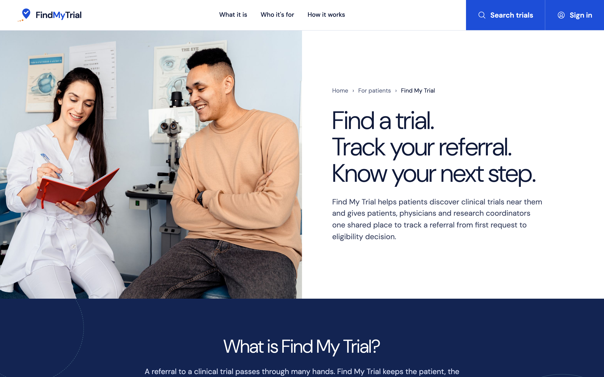
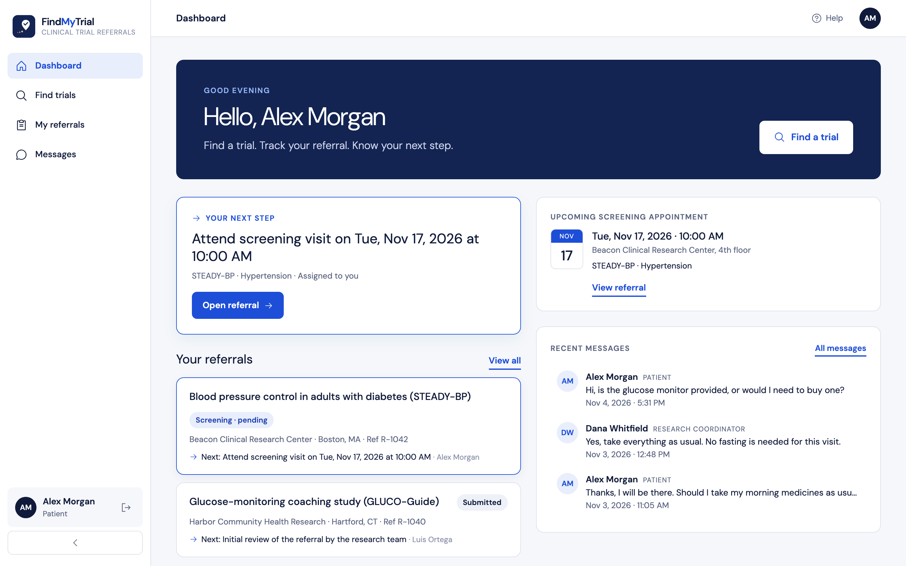
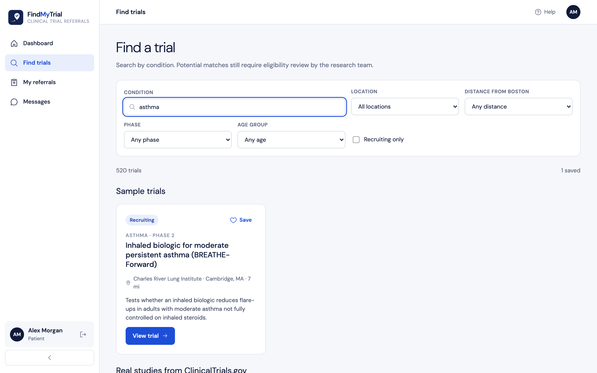
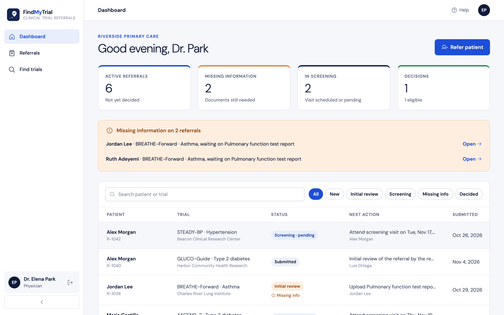
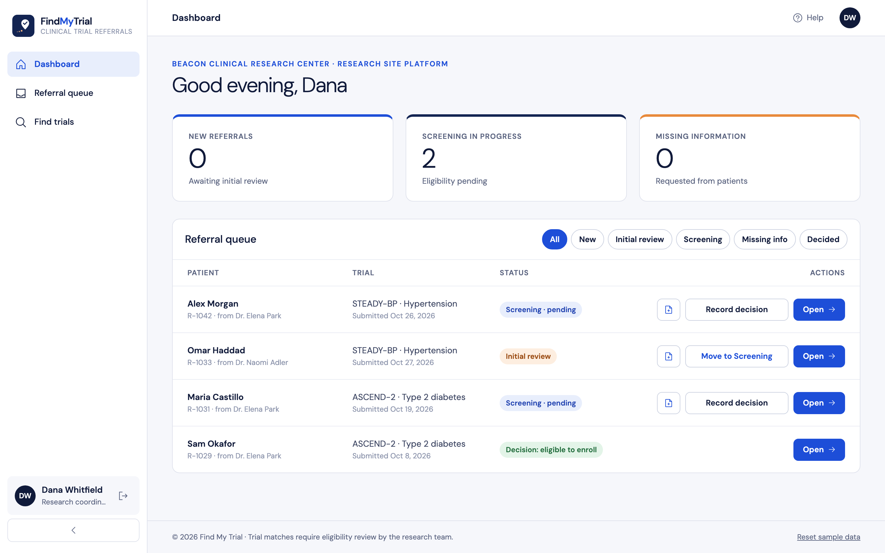
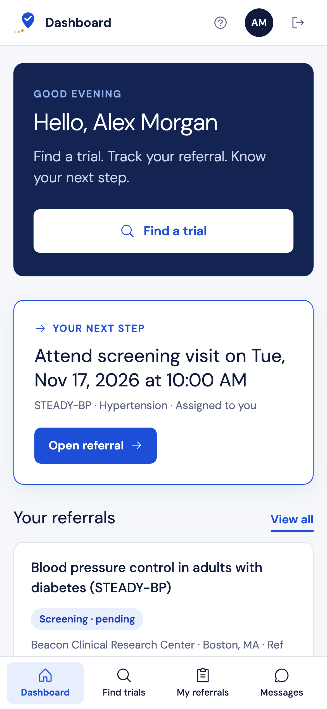

# Find My Trial

Find a trial. Track your referral. Know your next step.

Find My Trial helps patients find clinical trials near them. It gives patients, physicians and research coordinators one shared place to track a referral, from the first request to the eligibility decision.

**Live demo: https://findmytrial-zeta.vercel.app**

This is a demo. Each portal runs on sample accounts and stores its data in your browser's localStorage, so there is no real sign-in and nothing syncs between devices. Real studies come live from ClinicalTrials.gov. They are shown for contact only, and referrals go only to the sample trials.

## Screenshots

### Website


### Patient portal



### Physician portal


### Research coordinator portal


### On a phone


## Project layout

| Path | What it is |
| --- | --- |
| `website/` | Marketing site (React + Vite), served at `/` |
| `app/` | Patient, physician and coordinator portals (React + Vite + React Router), served at `/app` |
| `ctgov-proxy.mjs` | Caching proxy for the ClinicalTrials.gov API |
| `api/ctgov.mjs` | Vercel function that wraps the proxy |
| `serve.mjs` | Local server that serves both builds and the proxy |
| `vercel.json` | Vercel build and rewrites |

## Running locally

```bash
npm ci --prefix website && npm ci --prefix app
npm run build      # builds website/ and app/
npm start          # serves both plus the registry proxy
```

For portal development only: `cd app && npm run dev`.

## Tests

```bash
npm test                      # registry proxy (node:test)
cd app && npm test            # domain unit tests (Vitest)
cd app && npm run test:e2e    # portal end-to-end tests (Playwright)
cd app && BASE_URL=https://findmytrial-zeta.vercel.app npm run test:combined   # against the live site
```

## Deploying

Production is the Vercel project `findmytrial`. It is deployed from the CLI and is not connected to Git:

```bash
vercel deploy --prod --yes
```
